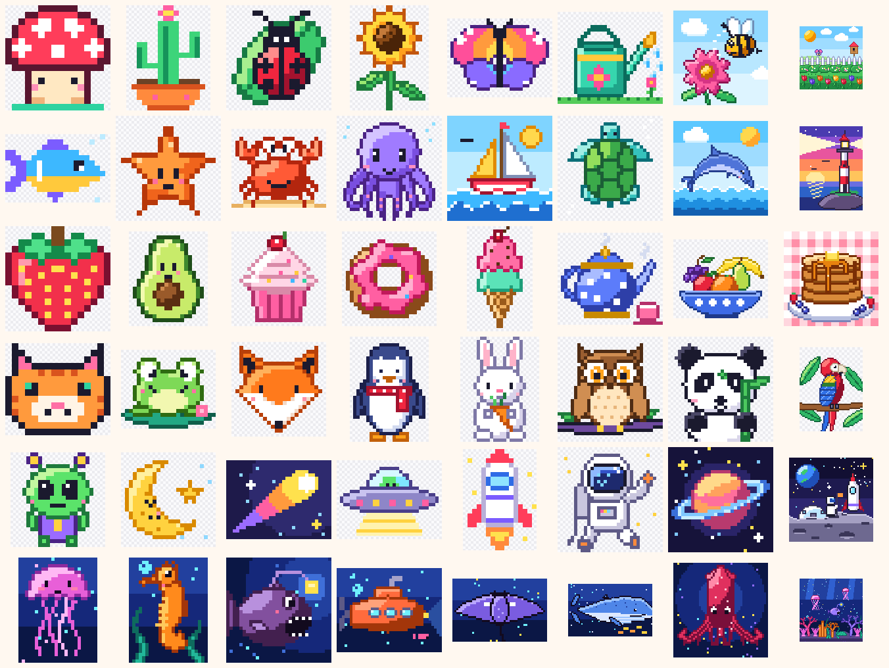

# Crédits du contenu

Toutes les illustrations livrées avec FingerPaint (48 œuvres, 6 albums) sont des **créations originales de FingerPaint**. Elles sont produites par code dans ce dépôt, sans source externe :

- `scripts/art/starter.mjs` : les 6 œuvres de départ, en cartes ASCII dessinées à la main ;
- `scripts/art/<album>.mjs` : les 42 autres œuvres, dessinées avec le petit moteur `scripts/art/engine.mjs` (formes, symétries, contours, ombrage et dégradés quantifiés) ;
- `node scripts/generate-art.mjs` régénère les JSON et le manifeste `src/content/index.ts`. `--preview <dossier>` produit des aperçus PNG et une planche-contact pour la revue visuelle.

Aucune œuvre ne reprend une marque, un logo, un personnage ou un univers existant protégé. Les sujets sont génériques : animaux, plantes, nourriture, objets, paysages. Aucune image tierce, aucun jeu de données et aucune banque d'images n'a servi à les produire.

**Droits** : © FingerPaint. Le contenu est distribué avec l'application. Il ne relève pas d'une licence libre.

## Ajouter une œuvre d'un·e artiste

1. Dessiner l'œuvre en PNG, à raison d'un pixel par case. Les pixels transparents restent des cases vides.
2. La convertir : `node scripts/png-to-artwork.mjs art.png --id <id> --album <album> --title-fr "…" --title-en "…" [--access free|pro|pack:<id>] [--difficulty 1|2|3] [--max-colors 24]`.
3. Relancer `node scripts/generate-art.mjs` pour mettre à jour le manifeste (les fichiers importés y sont conservés), puis `npm run validate:art`.
4. Ajouter une ligne ci-dessous, avec le nom de l'artiste et la licence (cession ou licence exclusive à FingerPaint).

## Répartition

- 32 œuvres gratuites, 8 Pro réparties dans les albums gratuits (les plus détaillées) et 8 dans le pack `ocean` (tout l'album Océan profond).
- Les œuvres font de 16 à 64 px de côté, sauf deux grandes scènes de 96×96 (« Le jardin en fleurs », « Le récif des abysses »).
- Elles comptent de 6 à 23 couleurs, avec un ΔE76 d'au moins 10 entre deux couleurs.
- Le contenu total pèse moins de 70 Ko, soit nettement moins que la limite de 1 Mo vérifiée par `src/content/content.test.ts`.

## Inventaire

### Jardin / Garden (`garden`)

| Œuvre | FR | EN | Taille | Couleurs | Difficulté | Accès |
| --- | --- | --- | --- | --- | --- | --- |
| `happy-mushroom` | Champignon joyeux | Happy mushroom | 16×16 | 8 | 1 | Gratuit |
| `potted-cactus` | Cactus en pot | Potted cactus | 16×20 | 7 | 1 | Gratuit |
| `ladybug` | Coccinelle sur sa feuille | Ladybug on a leaf | 20×20 | 8 | 1 | Gratuit |
| `sunflower` | Tournesol | Sunflower | 24×32 | 9 | 1 | Gratuit |
| `butterfly` | Papillon arc-en-ciel | Rainbow butterfly | 32×24 | 8 | 2 | Gratuit |
| `watering-can` | L'arrosoir | Watering can | 32×28 | 11 | 2 | Gratuit |
| `bee-and-flower` | Abeille et cosmos | Bee and cosmos | 48×48 | 17 | 3 | Pro |
| `flower-garden` | Le jardin en fleurs | Garden in bloom | 96×96 | 23 | 3 | Pro |

### Océan / Ocean (`ocean`)

| Œuvre | FR | EN | Taille | Couleurs | Difficulté | Accès |
| --- | --- | --- | --- | --- | --- | --- |
| `tropical-fish` | Poisson tropical | Tropical fish | 20×13 | 6 | 1 | Gratuit |
| `starfish` | Étoile de mer | Starfish | 20×20 | 6 | 1 | Gratuit |
| `crab` | Crabe rigolo | Cheerful crab | 24×20 | 7 | 1 | Gratuit |
| `octopus` | Poulpe câlin | Cuddly octopus | 32×32 | 8 | 2 | Gratuit |
| `sailboat` | Petit voilier | Little sailboat | 32×32 | 12 | 2 | Gratuit |
| `sea-turtle` | Tortue de mer | Sea turtle | 32×32 | 8 | 2 | Gratuit |
| `dolphin` | Saut de dauphin | Leaping dolphin | 48×48 | 14 | 3 | Pro |
| `lighthouse` | Phare au couchant | Lighthouse at sunset | 48×64 | 19 | 3 | Pro |

### Cuisine / Kitchen (`kitchen`)

| Œuvre | FR | EN | Taille | Couleurs | Difficulté | Accès |
| --- | --- | --- | --- | --- | --- | --- |
| `strawberry` | Fraise | Strawberry | 16×16 | 7 | 1 | Gratuit |
| `avocado` | Avocat souriant | Smiling avocado | 20×24 | 9 | 1 | Gratuit |
| `cupcake` | Cupcake à la cerise | Cherry cupcake | 24×24 | 12 | 1 | Gratuit |
| `donut` | Beignet glacé | Glazed donut | 24×24 | 9 | 1 | Gratuit |
| `ice-cream` | Cornet deux boules | Double scoop cone | 20×32 | 13 | 2 | Gratuit |
| `teapot` | Théière à pois | Polka-dot teapot | 32×28 | 9 | 2 | Gratuit |
| `fruit-bowl` | Corbeille de fruits | Fruit bowl | 48×40 | 20 | 3 | Pro |
| `pancake-stack` | Pile de crêpes épaisses | Pancake stack | 48×48 | 18 | 3 | Pro |

### Animaux / Animals (`animals`)

| Œuvre | FR | EN | Taille | Couleurs | Difficulté | Accès |
| --- | --- | --- | --- | --- | --- | --- |
| `tabby-cat` | Chat tigré | Tabby cat | 16×14 | 6 | 1 | Gratuit |
| `frog` | Grenouille sur son nénuphar | Frog on a lily pad | 24×20 | 10 | 1 | Gratuit |
| `fox` | Renard malicieux | Clever fox | 24×24 | 7 | 1 | Gratuit |
| `penguin` | Pingouin en écharpe | Penguin in a scarf | 24×32 | 9 | 1 | Gratuit |
| `bunny` | Lapin et sa carotte | Bunny with a carrot | 24×32 | 10 | 2 | Gratuit |
| `owl` | Chouette sur sa branche | Owl on a branch | 32×32 | 12 | 2 | Gratuit |
| `panda` | Panda gourmand | Hungry panda | 32×32 | 7 | 2 | Gratuit |
| `parrot` | Perroquet des tropiques | Tropical parrot | 48×64 | 20 | 3 | Pro |

### Espace / Space (`space`)

| Œuvre | FR | EN | Taille | Couleurs | Difficulté | Accès |
| --- | --- | --- | --- | --- | --- | --- |
| `friendly-alien` | Petit extraterrestre | Friendly alien | 24×24 | 9 | 1 | Gratuit |
| `sleepy-moon` | Lune endormie | Sleepy moon | 24×24 | 6 | 1 | Gratuit |
| `comet` | Comète filante | Shooting comet | 32×24 | 8 | 1 | Gratuit |
| `flying-saucer` | Soucoupe volante | Flying saucer | 32×24 | 10 | 1 | Gratuit |
| `little-rocket` | Petite fusée | Little rocket | 16×22 | 8 | 2 | Gratuit |
| `astronaut` | Astronaute en apesanteur | Floating astronaut | 32×32 | 11 | 2 | Gratuit |
| `ringed-planet` | Planète à anneaux | Ringed planet | 32×32 | 11 | 2 | Gratuit |
| `moon-base` | La base lunaire | Moon base | 64×64 | 19 | 3 | Pro |

### Océan profond / Deep ocean (`deep-ocean`, pack `ocean`)

| Œuvre | FR | EN | Taille | Couleurs | Difficulté | Accès |
| --- | --- | --- | --- | --- | --- | --- |
| `jellyfish` | Méduse lumineuse | Glowing jellyfish | 24×32 | 9 | 1 | Pack ocean |
| `seahorse` | Hippocampe | Seahorse | 24×32 | 12 | 2 | Pack ocean |
| `anglerfish` | Baudroie et sa lanterne | Anglerfish and its lantern | 32×32 | 13 | 2 | Pack ocean |
| `submarine` | Sous-marin d'exploration | Explorer submarine | 40×32 | 14 | 2 | Pack ocean |
| `manta-ray` | Raie manta | Manta ray | 48×32 | 9 | 2 | Pack ocean |
| `blue-whale` | La grande baleine | The great whale | 64×40 | 11 | 2 | Pack ocean |
| `giant-squid` | Calmar géant | Giant squid | 48×48 | 12 | 3 | Pack ocean |
| `abyss-reef` | Le récif des abysses | The abyssal reef | 96×96 | 22 | 3 | Pack ocean |

